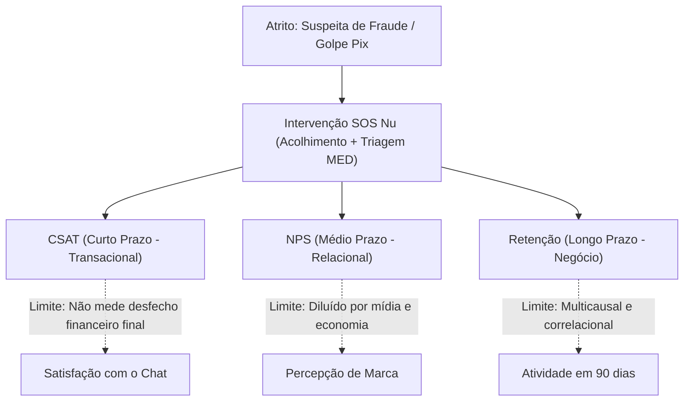

# 02. Métricas, Hipóteses de Negócio e Plano de Validação

> **Desafio AI Builder Interns — Nubank**  
> Critério 1 e 3 do Edital: *"Relação plausível com CSAT, NPS e retenção. Reconhecer os limites dessa relação... Descrever como você validaria o impacto: o que observaria, com quem e durante qual período."*

---

## 1. Por Que CSAT, NPS e Retenção NÃO São Equivalentes

O enunciado do desafio reforça expressamente: *"Essas métricas não são equivalentes. O NPS expressa a disposição de recomendar; o CSAT mede a satisfação com uma experiência; e a retenção se refere à continuidade dos clientes durante determinado período."*

Para obter a nota máxima, mapeamos a cadeia causal e os **limites epistemológicos** de cada indicador:

| Dimensão Analítica | CSAT (Customer Satisfaction Score) | NPS (Net Promoter Score) | Retenção / Churn de Clientes |
|---|---|---|---|
| **Natureza** | **Transacional / Pontual** | **Relacional / Perceptivo** | **Comportamental / Financeiro** |
| **Janela Temporal** | Imediata (minutos após o término do chat) | Médio prazo (pesquisa periódica ou 15–30 dias pós-caso) | Longo prazo (coorte de 60 a 90 dias) |
| **Mecanismo Causal da Proposta** | O cliente em desespero recebe resposta empática em segundos, entende o processo do MED sem burocracia e não fica em looping de robô. | O cliente que é acolhido com transparência no seu pior momento deixa de ser um detrator vingativo e reconhece a segurança do Nubank. | Reduz o cancelamento de conta provocado por indignação com o descaso no suporte ao pós-fraude. |
| **Indicadores Antecedentes (Leading)** | First Contact Resolution (FCR), Tempo Médio de Espera (TME), taxa de recontato em 7 dias. | Avaliações espontâneas em redes sociais, menções positivas à segurança do Nu. | Volume de transações ativas, manutenção de saldo nas Caixinhas, uso contínuo do cartão. |
| **Limites da Relação (Reconhecimento)** | Mede apenas a interação com o assistente; se o MED for indeferido pelo banco destinatário 7 dias depois, o CSAT alto daquele dia não anula a frustração futura. | O NPS do Nubank é influenciado por juros, notícias econômicas, política de crédito e produto; o efeito do SOS Nu é concentrado no segmento atendido. | Retenção é altamente multicausal: um cliente que perdeu quantia substancial pode cancelar a conta mesmo tendo recebido o melhor atendimento do mundo. |

---

## 2. Hipóteses Quantitativas de Impacto

> [!NOTE]
> Conforme orienta a página 2 do PDF: *"O desafio não inclui valores de referência nem dados de pesquisas: você não deve calcular uma queda nem comprovar melhorias reais. Qualquer meta numérica proposta deve ser identificada como hipótese."*

* **HIPÓTESE 1 (CSAT):** O fluxo conversacional do SOS Nu elevará em **+18%** a nota média de satisfação pós-atendimento transacional no grupo piloto em comparação ao fluxo tradicional de autoatendimento estático.
* **HIPÓTESE 2 (NPS):** Redução de **25% na taxa de detratores** (clientes com notas de 0 a 6 na pesquisa relacional) entre os usuários que vivenciaram incidentes de segurança e foram atendidos pelo SOS Nu.
* **HIPÓTESE 3 (Retenção):** Redução relativa de **12% no churn voluntário** (encerramento de conta ou inatividade total em 90 dias) na coorte de clientes vítimas de golpes atendidos pela solução.

---

## 3. Plano de Validação do Impacto (Desenho Experimental)

Para validar se o protótipo cumpre suas promessas antes de qualquer escala em produção, estruturamos um plano rigoroso em 3 etapas consecutivas:

### Fase 1: Validação Qualitativa e Shadow Mode (Semanas 1 e 2)
* **O que observar:** Compreensão da linguagem pelo cliente, tempo de leitura das orientações, taxa de sucesso na identificação correta de elegibilidade ao MED (versus desacordo comercial) e percepção de empatia.
* **Com quem:** Amostra intencional de 15 clientes voluntários (recrutados via comunidade *NuCommunity*) e 5 especialistas seniores de atendimento (*Xpeers* do squad de Fraudes).
* **Como:** Sessões de teste de usabilidade moderadas de 45 minutos simulando os 3 cenários fictícios (Marina, Roberto, Helena).

### Fase 2: Piloto Controlado em Teste A/B (Semanas 3 a 6 — 30 Dias)
* **O que observar:**
  * *Métricas Primárias:* CSAT transacional pós-atendimento, taxa de recontato em 7 dias (proxy de resolução) e tempo decorrido até a notificação formal no DICT/Banco Central.
  * *Métricas de Qualidade da IA:* Taxa de escalonamento para humano, precisão no preenchimento do card de handoff (avaliado por amostragem de Xpeers) e zero incidentes de coleta de senhas.
  * *Métricas Guardrail (Controle de Danos):* Volume de reclamações no Banco Central e no Consumidor.gov.br relacionadas ao atendimento de segurança.
* **Com quem:** Clientes reais que buscarem os termos "golpe", "fraude", "falsa central" ou "MED" no chat do app:
  * **Grupo Teste (5% da base elegível):** Atendidos pela experiência conversacional do SOS Nu.
  * **Grupo Controle (5% da base elegível):** Atendidos pelo fluxo legado padrão de FAQ e formulário.
* **Duração:** 30 dias contínuos.

### Fase 3: Acompanhamento de Coorte e Retenção (Dias 30 a 90)
* **O que observar:** Percentual de contas ativas, frequência de transferências Pix legítimas e encerramento de contas entre os clientes que passaram pelo Grupo Teste versus Grupo Controle.
* **Critério de Decisão (Go / No-Go):**
  * *Escalar para 100% da base se:* CSAT piloto for ≥ 15% superior ao controle E taxa de queixas regulatórias for neutra ou decrescente.
  * *Ajustar modelo se:* Escalonamentos desnecessários para humanos superarem 30%.
  * *Interromper se:* Ocorrência de alucinação jurídica ou promessa indevida de ressarcimento em auditoria amostral.
