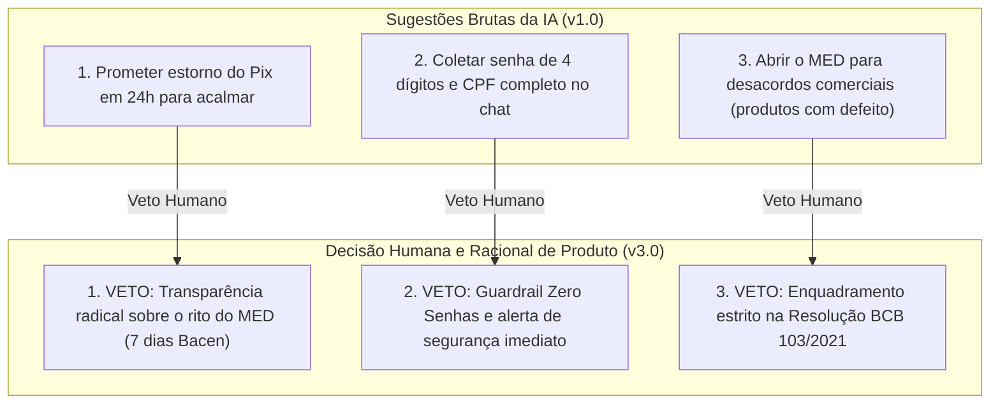

# 03. Uso de IA e Decisões Revisadas por Conta Própria

> **Desafio AI Builder Interns — Nubank**  
> Critério 4 do Edital: *"Uso adequado de IA e revisão de suas sugestões, demonstrando capacidade de explicar as próprias decisões."*  
> Requisito da Página 4: *"Explique brevemente como você utilizou IA e apresente uma decisão que revisou por conta própria. Você deverá ser capaz de explicar as instruções, os dados e as decisões da sua solução, mesmo que tenha utilizado IA para criá-los."*

---

## 1. Como a IA Foi Utilizada no Desenvolvimento

O projeto utilizou modelos de linguagem e ferramentas de IA generativa como **aceleradores de produtividade e ideação**, atuando em quatro frentes específicas:
1. **Mapeamento de Padrões Públicos de Queixas:** Síntese de relatos públicos do Reclame Aqui e tópicos mais frequentes sobre o Pix para identificação rápida dos momentos de maior atrito.
2. **Geração de Casos de Teste Sintéticos:** Criação de variações de mensagens de clientes em diferentes estados emocionais (pânico, gírias, erros de digitação, tentativas de manipulação e prompts em espanhol).
3. **Estruturação Inicial do Rascunho de Prompt:** Elaboração da primeira versão das instruções de sistema (`v1.0`).
4. **Refinamento de Código React/TypeScript:** Apoio na componentização da interface e integração com o SDK oficial `@google/genai`.

---

## 2. As Três Decisões Críticas Revisadas por Conta Própria

Para garantir que a solução atendesse à realidade regulatória bancária e à cultura de segurança do Nubank, **o julgamento humano interveio e alterou deliberadamente três propostas geradas pela IA**:

---

### Decisão Principal: Veto à Falsa Promessa de Estorno em 24 Horas
* **A sugestão original da IA (v1.0):**  
  Buscando gerar empatia imediata, a IA redigiu a seguinte instrução:  
  *`"Diga ao cliente para ficar tranquilo porque o Nubank vai cancelar a transação Pix e estornar o dinheiro na conta dele em até 24 horas úteis."`*
* **A MINHA DECISÃO HUMANA (VETO):**  
  Vetei essa sugestão imediatamente e substituí pela regra da **Transparência Radical**:  
  *`"NUNCA prometa devolução automática ou estorno garantido. Explique que o Nubank abre a notificação oficial do MED no Banco Central, as instituições receptoras bloqueiam cautelarmente o saldo que ainda estiver disponível e a análise leva até 7 dias corridos."`*
* **Racional de Negócio e Risco:**  
  *Pela Resolução BCB nº 103/2021, o banco de origem **não tem poder legal de desfazer um Pix unilateralmente**. O sucesso da devolução depende estritamente de haver saldo retido na conta do fraudador no banco de destino.*  
  *Prometer devolução em 24h acalma o cliente no minuto 1 (gerando um CSAT falso), mas provoca uma **quebra irreparável de confiança no 7º dia** se o valor não puder ser recuperado. O cliente sentir-se-á enganado pelo Nubank, tornando-se um detrator vocal que cancela a conta e aciona a Justiça. A fidelidade do cliente constrói-se com a verdade, não com promessas impossíveis.*

---

### Decisão Secundária 1: Imposição do Guardrail "Zero Senhas"
* **A sugestão original da IA (v1.0):**  
  *`"Se o cliente disser que caiu num golpe, peça o CPF completo, a senha do cartão e os dados da transação para resolvermos rápido."`*
* **A MINHA DECISÃO HUMANA (VETO):**  
  Implementei a **Regra da Senha Zero**:  
  *`"O assistente jamais solicita ou aceita senhas de 4/8 dígitos, tokens ou CVV. Se o usuário digitar espontaneamente qualquer código no chat, o assistente emite um alerta de segurança imediato e orienta a troca da senha no app."`*
* **Racional de Segurança:**  
  *O Nubank tem como pilar institucional a proteção de dados e conformidade com a LGPD e resoluções de segurança do Bacen. Um chatbot bancário jamais pode incentivar o hábito de digitar senhas em texto puro em chats, pois isso treina o usuário a ser vulnerável a ataques de phishing.*

---

### Decisão Secundária 2: Enquadramento Regulatório do MED vs. Desacordo Comercial
* **A sugestão original da IA (v1.0):**  
  A IA tratava qualquer queixa de compra frustrada como candidata ao MED, inclusive tênis com defeito ou atraso de frete em lojas físicas legítimas.
* **A MINHA DECISÃO HUMANA (VETO):**  
  Criei um bloco de prompt dedicado à **Elegibilidade Regulatória (Res. BCB 103/2021 e 493/2025)**, orientando o assistente a explicar com gentileza por que desacordos comerciais não são cobertos pelo MED e encaminhando o cliente para o Procon ou para o lojista.
* **Racional Operacional:**  
  *Abrir notificações de MED indevidas gera sobrecarga nos canais do Banco Central, atrito com outros bancos e gera penalidades regulatórias para a instituição.*

---

## 3. Explicação dos Parâmetros Técnicos Escolhidos

Durante a banca, você pode ser questionado sobre a configuração técnica no Google AI Studio:
* **Modelo: `Gemini 2.5 Flash` (com opção para `Gemini 2.5 Pro`)**  
  *Por que Flash?* Latência ultrabaixa (< 800ms por turno), custo zero de processamento e excelente capacidade de seguir instruções estruturadas em português.  
  *Por que Pro?* Pode ser alternado no seletor da interface se o painel desejar testar raciocínio analítico para cenários jurídicos complexos.
* **Temperatura: `0.3` (Baixa)**  
  *Por que 0.3 e não 0.7 ou 1.0?*  
  Em cenários financeiros e de conformidade regulatória com o Banco Central, a criatividade do modelo deve ser minimizada. Uma temperatura baixa garante que o modelo seja **determinístico, fiel aos guardrails de segurança e consistente na aplicação dos prazos do MED**, sem alucinar regras inexistentes.
